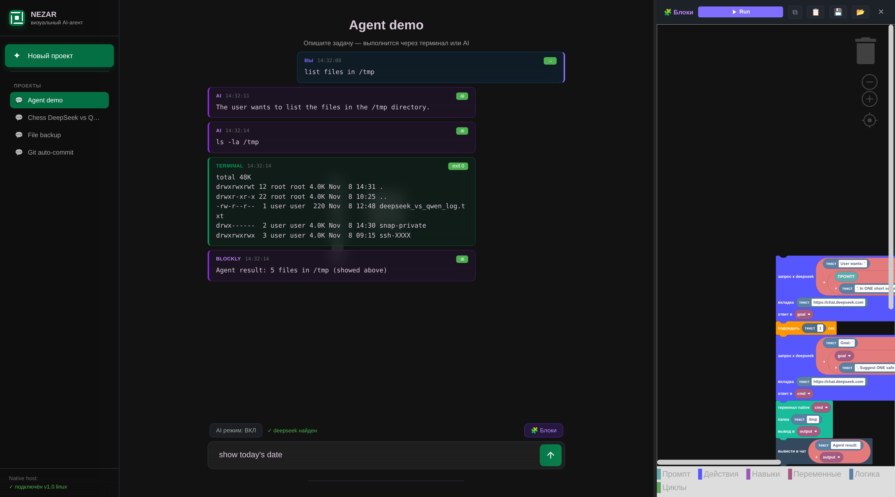
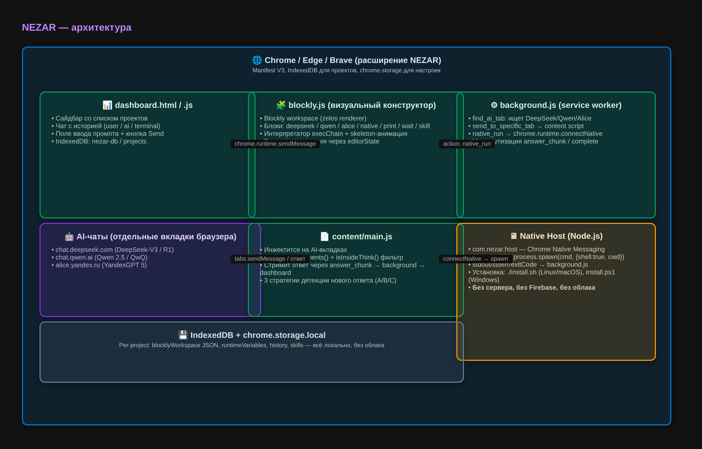
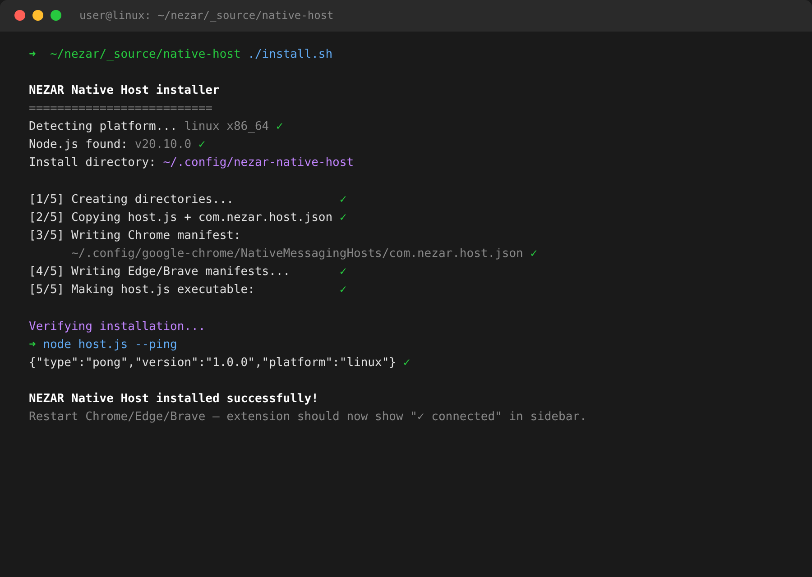
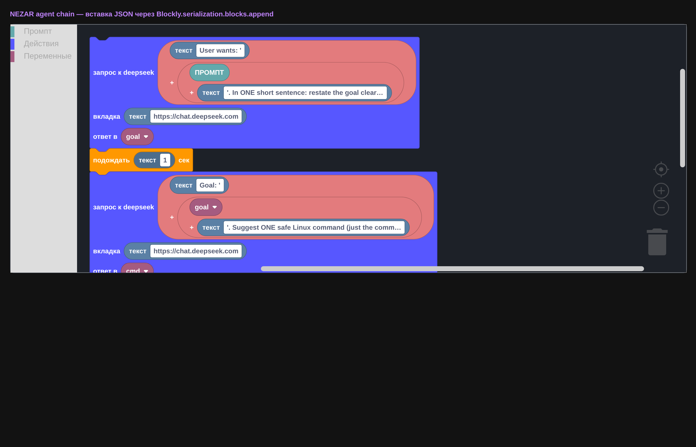
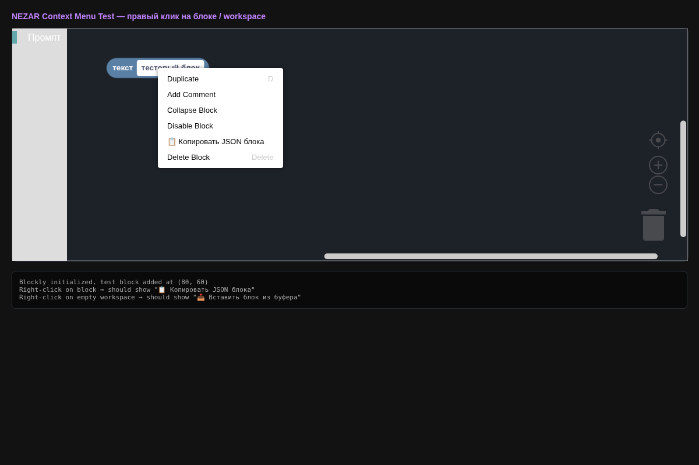
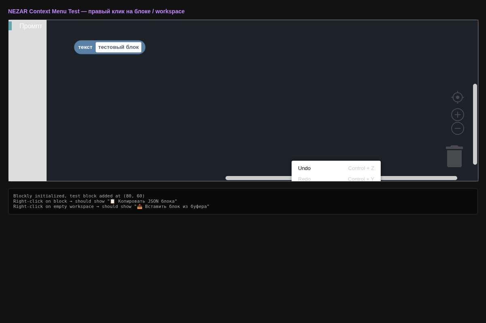
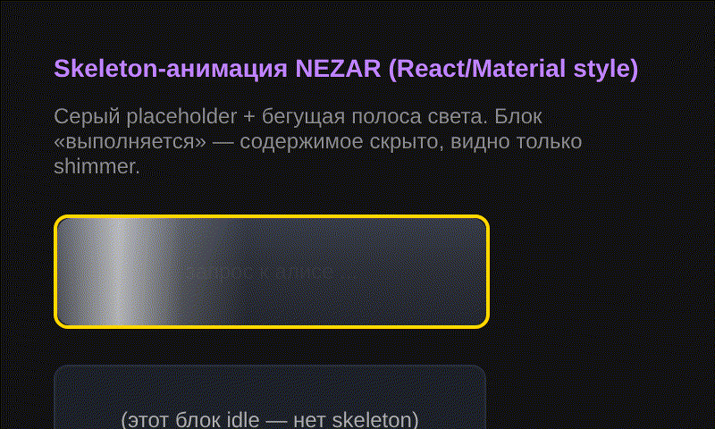

# 🧩 NEZAR — визуальный AI-агент

**Бесплатное браузерное расширение: Blockly-блоки + web-чаты AI + терминал ОС.**
Без API-ключей, без облака, без Firebase.



---

## 📌 Что такое NEZAR

NEZAR — это **визуальный конструктор AI-агентов** в виде Chrome-расширения. Вы собираете цепочку из блоков (как в Scratch), которые могут:

- 🤖 Отправлять запросы в **DeepSeek**, **Qwen**, **Яндекс Алису** через их web-чаты (БЕЗ API-ключей — используются уже открытые вкладки)
- 🖥 Выполнять терминальные команды через **Native Messaging** (прямой доступ к ОС, без сервера)
- 🔗 Комбинировать AI-размышления и выполнение в одной цепочке
- 💾 Хранить каждый чат как отдельный проект со своими блоками

**Ближайший аналог:** n8n + Ollama, но в 100 раз проще в установке (одна команда `./install.sh`) и не требует ничего кроме Chrome.

---

## ✨ Ключевые возможности

| Фича | Описание |
|---|---|
| 🆓 **$0 за AI** | Использует web-интерфейсы DeepSeek/Qwen/Алисы — без API-ключей |
| 🧩 **Blockly** | Визуальное программирование без кода (zelos renderer) |
| 🖥 **Native Messaging** | Терминал ОС без сервера — через Chrome Native Messaging |
| 💬 **Per-project изоляция** | Каждый чат = отдельный проект со своими блоками, переменными, историей |
| 🔄 **3 AI провайдера** | DeepSeek + Qwen + Яндекс Алиса в одном workspace |
| 📋 **Right-click меню** | Copy/Paste JSON блоков через системный буфер обмена |
| ✨ **Skeleton-анимация** | React-style placeholder + shimmer на выполняемом блоке |
| ⏹ **Run/Stop** | Контроль выполнения: можно прервать на любом этапе |
| 📤 **Экспорт/импорт** | Блоки в `.nezar.json` файлы — переносимость между проектами |
| 🔒 **Приватность** | IndexedDB локально, никакой телеметрии, без облака |
| 🌐 **Кроссплатформенный** | Linux, macOS, Windows + Chrome, Edge, Brave |

---

## 🏗 Архитектура



**Поток выполнения цепочки:**

```
[Блок «запрос к deepseek»]
       │
       ▼  chrome.runtime.sendMessage({action:'find_tab_by_url'})
[background.js] ────► [content/main.js на вкладке DeepSeek]
                            │  inject_and_send → DeepSeek генерирует ответ
                            ▼  answer_chunk → background → dashboard
                  [переменная AI_RESPONSE сохранена]
       │
       ▼
[Блок «терминал native»]
       │
       ▼  chrome.runtime.sendMessage({action:'native_run'})
[background.js] ────► chrome.runtime.connectNative('com.nezar.host')
                            │
                            ▼  child_process.spawn(cmd, {shell:true})
                     [Native Host (Node.js)]
                            │  stdout/stderr/exitCode
                            ◄───────────────────
                  [переменная OUTPUT сохранена]
       │
       ▼
[Блок «вывести в чат»]
```

---

## 📥 Установка

NEZAR состоит из двух частей:
1. **Браузерное расширение** — UI, блоки, маршрутизация
2. **Native Host** — Node.js-программа для выполнения терминальных команд

### Шаг 1: Установить расширение в Chrome/Edge/Brave

1. Скачайте ZIP `NEZAR_v1.0_no_firebase.zip` и распакуйте в любую папку.
2. Откройте `chrome://extensions` (или `edge://extensions`, `brave://extensions`).
3. Включите **Developer mode** (правый верхний угол).
4. Нажмите **Load unpacked** → выберите папку `nezar-extension-clean/`.
5. NEZAR появится в списке расширений. Закрепите иконку в тулбаре.

### Шаг 2: Установить Native Host

Native Host нужен для блока «терминал native». Без него AI-блоки работают, терминал — нет.

**Linux / macOS / Windows (Git Bash) — универсальный установщик:**
```bash
cd nezar-extension-clean/native-host/
./install.sh
```

Установщик сам определит ОС, спросит Extension ID (32 буквы из `chrome://extensions`), запустит нужный `install-{os}.js`, и установит CLI-команду `nezar`.

**Альтернатива — напрямую через Node (если `install.sh` не запускается):**
```bash
# Linux:
cd nezar-extension-clean/native-host/
node install-linux.js

# macOS:
node install-macos.js

# Windows (в PowerShell):
node install-windows.js
```

**Windows (PowerShell — нативный установщик):**
```powershell
cd nezar-extension-clean\native-host\
.\install.ps1
```

Все установщики попросят **Extension ID** — найди его в `chrome://extensions/` → карточка NEZAR → 32-символьный ID (например `dknofjkomgdkafpokoppfgpiohfbdnml`).



После установки **перезапустите браузер** — в сайдбаре NEZAR появится статус «✓ подключён v1.0 linux».

### Шаг 3: Открыть AI-вкладки

Для работы AI-блоков нужно, чтобы в браузере была открыта соответствующая вкладка (любая, можно в фоне):

- 🟦 **DeepSeek:** https://chat.deepseek.com — залогиньтесь
- 🟣 **Qwen:** https://chat.qwen.ai — залогиньтесь
- 🔴 **Алиса:** https://alice.yandex.ru — залогиньтесь Я.аккаунтом

NEZAR сам найдёт открытую вкладку через `chrome.tabs.query()`.

---

## 🚀 Quick Start (5 минут)

1. Кликните по иконке NEZAR в тулбаре → откроется dashboard.
2. В сайдбаре нажмите **«✦ Новый проект»**.
3. В правой панели Blockly (открыта по умолчанию) соберите цепочку:
   - Перетащите блок **«запрос к deepseek»** из категории «Действия»
   - В поле «вкладка» подставьте блок «текст» со значением `https://chat.deepseek.com`
   - В поле «ответ в» подставьте блок «переменная» → создайте переменную `ai_result`
4. В поле ввода промпта (внизу слева) напишите: `What is 2+2? Reply with just the number.`
5. Нажмите **▶ Run** в шапке Blockly панели.
6. На блоке загорится **skeleton-анимация** (серый placeholder + бегущая полоса). DeepSeek ответит — значение сохранится в `ai_result`.
7. Готово! В чате появится пузырь с ответом AI.

### Готовая цепочка агента

В файле `nezar_agent_demo.nezar.json` — готовый агент из 5 блоков:
**Промпт → DeepSeek формулирует цель → DeepSeek предлагает команду → Терминал выполняет → Вывод результата**

Импорт: нажмите кнопку **📂** в шапке Blockly панели → выберите файл.



---

## 🧩 Блоки

| Категория | Блок | Описание |
|---|---|---|
| **Промпт** | `ПРОМПТ` | Текст из поля ввода чата |
| | `текст` | Строковая константа |
| | `+` | Конкатенация строк |
| **Действия** | `запрос к deepseek` | Отправить текст в DeepSeek, ответ в переменную |
| | `запрос к qwen` | То же для Qwen |
| | `запрос к алисе` | То же для Яндекса Алисы |
| | `терминал native` | Выполнить команду в ОС, вывод в переменную |
| | `открыть вкладку` | Открыть URL в новой вкладке браузера (в фоне, ждёт до 30с) |
| | `вывести в чат` | Добавить текст в чат как пузырь |
| **Навыки** | `навык %1 %2` | Определить функцию (имя + тело) |
| | `вызов скила` | Вызвать ранее определённый навык |
| **Переменные** | (стандартные Blockly) | `variables_get`, `variables_set` |
| **Логика** | `if` / `=` / `AND/OR` / `NOT` / `true/false` | Условия |
| **Циклы** | `repeat N` / `while` / `подождать N сек` | Повторение и паузы |

---

## 🖱 Right-click контекстное меню

На блоках и workspace доступно контекстное меню:

| Где правый клик | Пункт | Что делает |
|---|---|---|
| На блоке | **📋 Копировать JSON блока** | Сериализует блок в JSON, кладёт в OS clipboard |
| На workspace | **📥 Вставить блок из буфера** | Парсит JSON из буфера, вставляет блок в позицию клика |





**Поддерживаемые форматы буфера:**
- Single-block: `{"type":"nezar_send_deepseek", "inputs":{...}}`
- Full workspace state: `{"blocks":{"blocks":[...]}, "variables":[...]}` (берём первый top-level блок)

---

## ✨ Skeleton-анимация выполняемого блока

Когда блок начинает выполняться, NEZAR накладывает на него **React/Material-style skeleton**:
- **Base rect** — тёмно-серый placeholder, частично скрывает содержимое блока
- **Shimmer rect** — бегущая полоса света (5-stop animated gradient) поверх base
- **Тонкая золотая обводка** — метка active-блока (без пульсации)



Анимация работает через SVG `<defs>` с `<linearGradient>` и SMIL `<animate>` — не нагружает CPU.

---

## 💾 Per-project изоляция

Каждый чат = отдельный проект со своими блоками:

- IndexedDB `nezar-db` → store `projects` (version 2)
- При переключении проекта:
  1. Блоки старого проекта сохраняются в его запись
  2. Blockly workspace **очищается** (включая variable definitions)
  3. Блоки нового проекта загружаются из его записи
- Blockly инициализируется **eдиновременно** при загрузке dashboard — `selectProject()` всегда может очистить и загрузить блоки
- Защита от гонок: `editorState.isLoading` блокирует автосохранение во время программной загрузки
- Автосохранение: debounce 1 сек → memory, 5 сек → IndexedDB

---

## 📂 Структура проекта

```
nezar-extension-clean/
├── manifest.json              # Manifest V3, без Firebase
├── dashboard.html             # UI: sidebar + chat + Blockly panel
├── dashboard.js               # Логика: проекты, чат, AI-режим, Run/Stop
├── blockly.js                 # Блоки, интерпретатор, skeleton, context menu
├── background.js              # Service worker: AI-таб поиск + native messaging
├── content/main.js            # Content script для DeepSeek/Qwen/Алисы
├── blockly.min.js             # Blockly library
├── blocks_compressed.js       # Стандартные блоки Blockly
├── javascript_compressed.js   # Генератор JS (не используется, но нужен для Blockly)
├── blockly_msg_ru.js          # Русская локализация Blockly
├── icons/                     # 16/48/128 PNG
├── native-host/               # ⚡ Native Host для терминала
│   ├── install.sh             # Универсальный bash-установщик (Linux/macOS/Windows)
│   ├── install.ps1            # PowerShell-установщик для Windows
│   ├── install-linux.js       # Linux-специфичная установка
│   ├── install-macos.js       # macOS-специфичная установка
│   ├── install-windows.js     # Windows-специфичная установка (через Node)
│   ├── host.js                # Сам Native Host (Node.js + child_process.spawn)
│   ├── com.nezar.host.json    # Манифест для Chrome Native Messaging
│   ├── nezar-cli.sh           # CLI-команда `nezar` (status/test/uninstall)
│   ├── test-host.js           # Тесты native host (5 проверок)
│   └── README.md              # Документация по native host
├── docs/                      # Скриншоты для README
└── README.md                  # Этот файл
```

---

## ⚙ Как это работает — детали

### AI-запрос (блок «запрос к deepseek»)

```
1. blockly.js: nezarSendToDeepSeek(text, url, varName)
       │
       ▼  chrome.runtime.sendMessage({action:'find_tab_by_url', url})
2. background.js: ищет вкладку по URL через chrome.tabs.query({})
       │
       ▼  chrome.tabs.sendMessage(tabId, {action:'inject_and_send', text})
3. content/main.js: injectAndSend(text)
       │  setEditorText(textarea, text) + sendViaEnter + tryClickSendButton
       │  startStreaming(bindingId) — polling 500мс + MutationObserver
       ▼
4. AI-сайт генерирует ответ, content script ловит изменения через:
       - Strategy A: answers.length > knownAnswerCount (новый DOM-элемент)
       - Strategy B: text последнего answer-элемента изменился
       - Strategy C: chat area text вырос > 100 символов (broad fallback)
       │
       │  isInsideThink(el) — фильтр блоков размышления (.ds-think-content)
       │  extractAnswerText(el) — innerText → DOM-walk → paragraph join
       │
       ▼  chrome.runtime.sendMessage({action:'answer_chunk', text})
5. background.js форвардит в dashboard
       │
       ▼  chrome.runtime.onMessage.addListener
6. dashboard.js waitForAIResponse() resolve({text, think})
       │
       ▼
7. blocklyVariables[varName] = aiResp.text
```

### Терминал (блок «терминал native»)

```
1. blockly.js: nezarSendToNative(text, cwd, varName)
       │
       ▼  chrome.runtime.sendMessage({action:'native_run', command, cwd})
2. background.js: runNativeCommand(command, cwd, timeout)
       │
       ▼  chrome.runtime.connectNative('com.nezar.host')
3. Native Host (Node.js): child_process.spawn(command, {shell:true, cwd})
       │  Собирает stdout, stderr, exitCode
       ▼  port.postMessage({type:'done', stdout, stderr, exitCode})
4. background.js resolve({ok, stdout, stderr, exitCode})
       │
       ▼
5. blocklyVariables[varName] = output
6. addHistoryEntry({role:'assistant', text:output, exitCode})
```

### Завершение ответа AI (per-site)

| Сайт | Маркер завершения |
|---|---|
| **DeepSeek** | `div.ds-button__background` под ответом |
| **Qwen** | `button[aria-label="Поделиться"]` |
| **Алиса** | Любой из 4: `data-end-streaming-block`, `message-completion-marker`, `share-response-button`, `good-answer-button` |
| **Fallback** | Text-stability: текст не менялся 4 проверки подряд (~2 сек) |

---

## ⌨ Горячие клавиши

| Комбинация | Действие |
|---|---|
| `Enter` в поле промпта | Отправить / запустить блоки |
| `Ctrl/Cmd+B` | Свернуть/развернуть сайдбар |
| `Ctrl+Z` / `Ctrl+Shift+Z` | Undo/Redo в Blockly (стандартное) |
| `Right-click на блоке` | Контекстное меню → Copy JSON |
| `Right-click на workspace` | Контекстное меню → Paste JSON |

---

## 🛠 Troubleshooting

### Native host не подключён
- Проверьте: `chrome://extensions` → NEZAR → details → проверьте что nativeMessaging в permissions
- Перезапустите браузер после `./install.sh`
- В сайдбаре NEZAR нажмите «Перепроверить» рядом со статусом
- Логи: `chrome://extensions` → NEZAR → «Inspect views: service worker» → console

### AI-блок возвращает `(вкладка не найдена)`
- Откройте нужный AI-чат в новой вкладке, дождитесь полной загрузки
- В URL блока укажите правильный адрес (`https://chat.deepseek.com`, без слеша в конце не критично)
- Проверьте что вкладка не в состоянии loading — дождитесь `status: 'complete'`

### В ответ AI попадает «Thought for N seconds» (блок размышления)
- Это блок think — NEZAR фильтрует его через `isInsideThink()`
- Если всё равно попадает: откройте DevTools на вкладке AI → console → посмотрите лог `[nezar-content] FILTERED OUT think element`
- Если логов нет — селекторы в `content/main.js` устарели, пришлите HTML ответа для обновления

### Блоки не сохраняются per-project
- Убедитесь что dashboard загружен полностью перед переключением проекта
- В DevTools → Application → IndexedDB → nezar-db → projects — проверьте что у каждого проекта есть поле `blocklyWorkspace`
- Если поле пустое — блоки не сохранились, переоткройте проект и отредактируйте блоки (автосохранение через 1 сек)

### Скелетон-анимация не показывает
- Убедитесь что в DevTools → Elements на выполняемом блоке есть `<rect class="nezar-skeleton-base">` и `<rect class="nezar-skeleton-shimmer">`
- Если rect'ов нет — `injectShimmerDefs()` не отработал, проверьте консоль на ошибки
- Градиент `<linearGradient id="nezar-skeleton-shimmer-gradient">` должен быть в `<defs>` главного Blockly SVG

---

## 📜 Лицензия

MIT — делайте что хотите, но без warranty.

## 🙏 Благодарности

- [Blockly](https://developers.google.com/blockly/) — визуальное программирование от Google
- [DeepSeek](https://chat.deepseek.com/), [Qwen](https://chat.qwen.ai/), [Яндекс Алиса](https://alice.yandex.ru/) — за бесплатные web-чаты AI
- [Ice Studio](https://github.com/Ice-Studio) — за вдохновение для per-project editorState паттерна
